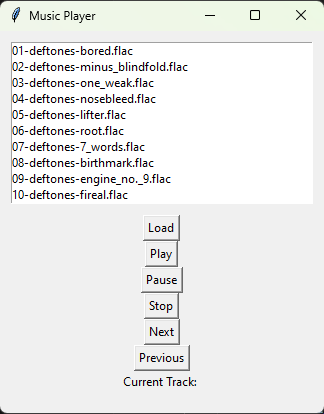

# Python Music Player

A desktop audio player built with Python and Tkinter. It uses pygame for playback and pydub and FFmpeg for audio handling.



## Run locally

Install Python with Tkinter support and put FFmpeg and FFprobe on your PATH. From the repository folder, install the Python dependencies and launch the player.

```bash
python -m pip install pygame pydub
python MusicPlayer.py
```

Use the file picker to add a local audio file and try the playback controls.
